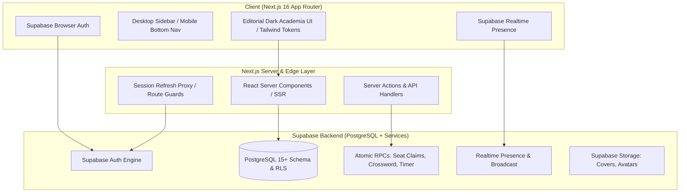
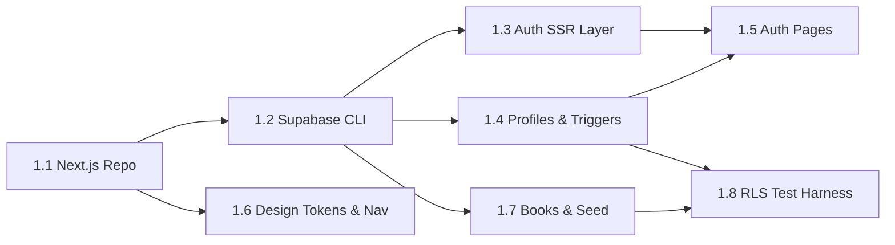
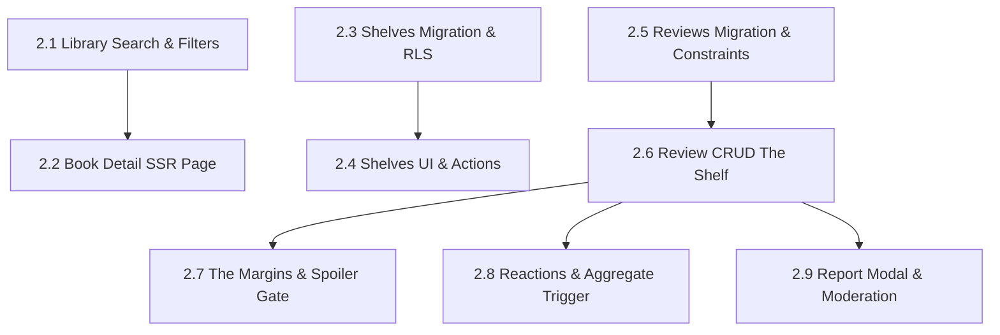
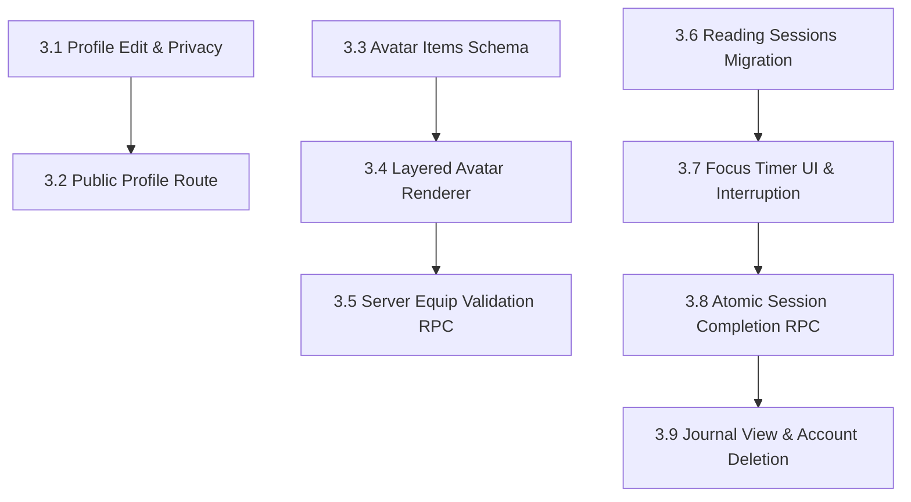
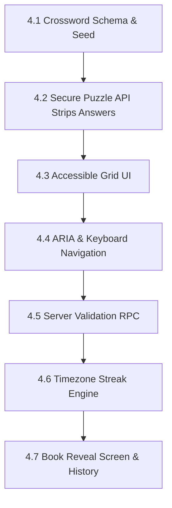
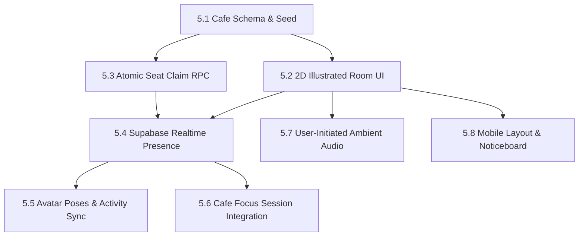
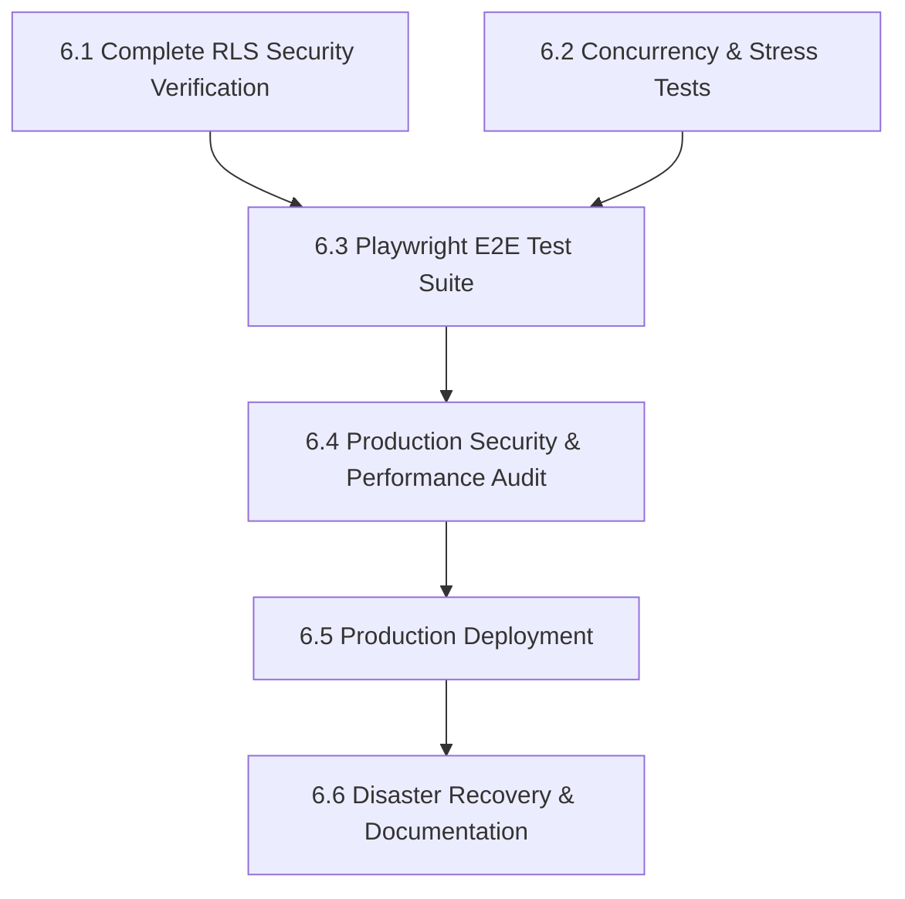

# DEAD POETS CLUB (DPC) — DETAILED EXECUTION PLAN BY PHASE

**Based on:** [Product Requirements Document (PRD v1.0)](file:///c:/Users/Shrawani/dead%20poet%20club/prd%20(1).md) & [Execution Plan (dpc_execution_plan.xlsx)](file:///c:/Users/Shrawani/dead%20poet%20club/dpc_execution_plan.xlsx)  
**Target Architecture:** Next.js 16 + TypeScript (App Router), Tailwind CSS (Custom Tokens), Supabase (Postgres, Auth, Realtime Presence, Storage, Edge Functions / RPCs)  
**Total Steps:** 47 discrete, testable steps across 6 phases

---

## Architecture & System Overview



---

## Phase 1: Foundation (Steps 1.1 – 1.8)

**Goal:** Establish repository architecture, dev/prod environments, authentication, profiles, row-level security foundation, design tokens, and curated catalogue seed.



### Step 1.1 — Repository & Project Scaffolding
- **Objective:** Scaffold modern Next.js 16 App Router with strict TypeScript, Tailwind CSS, ESLint, Prettier, and Git hygiene.
- **Tasks:**
  1. Initialize Next.js 16 with TypeScript (`src/` directory, App Router enabled).
  2. Configure ESLint (with `@typescript-eslint`), Prettier, and lint-staged hooks with Husky.
  3. Set up directory hierarchy per PRD Section 8:
     - `src/app/` (routes & layouts)
     - `src/components/{navigation,books,reviews,avatar,cafe,crossword,ui}/`
     - `src/services/` (strictly typed Supabase client calls)
     - `src/hooks/`, `src/types/`, `src/lib/`, `src/styles/`
     - `supabase/migrations/`, `supabase/seed.sql`
- **Acceptance Criteria:** `npm run dev`, `npm run lint`, and `npm run typecheck` pass cleanly with zero warnings.
- **Effort:** Small (`S`) | **Dependencies:** None

### Step 1.2 — Supabase Environment & CLI Setup
- **Objective:** Configure local Dockerized Supabase stack and separate cloud dev/prod projects.
- **Tasks:**
  1. Initialize `supabase init`.
  2. Configure `.env.local` with `NEXT_PUBLIC_SUPABASE_URL`, `NEXT_PUBLIC_SUPABASE_ANON_KEY`.
  3. Ensure `SUPABASE_SERVICE_ROLE_KEY` is restricted strictly to seed scripts/server tasks and never bundled in client code.
  4. Create `.env.example` with documented environment keys.
- **Acceptance Criteria:** `supabase start` executes locally; Postgres, Auth, and Studio run without errors.
- **Effort:** Small (`S`) | **Dependencies:** 1.1

### Step 1.3 — SSR Auth Client & Session Interception Layer
- **Objective:** Implement `@supabase/ssr` cookies handler and middleware proxy to ensure persistent authentication and safe route guards.
- **Tasks:**
  1. Implement `createClient` for browser (`src/lib/supabase/client.ts`).
  2. Implement `createClient` for Server Components, Server Actions, and Route Handlers (`src/lib/supabase/server.ts`).
  3. Implement `src/middleware.ts` to refresh expired tokens and protect authenticated paths:
     - Route guards on `/clubhouse`, `/cafe`, `/crossword`, `/shelves`, `/reviews`, `/journal`, `/settings`.
     - Unauthenticated requests redirect to `/login?returnTo=[path]`.
- **Acceptance Criteria:** Auth session seamlessly persists on page refresh and across browser tabs. Protected routes block unauthenticated guests.
- **Effort:** Medium (`M`) | **Dependencies:** 1.1, 1.2

### Step 1.4 — Database Migration: Profiles, Trigger & RLS
- **Objective:** Build canonical user profile table linked to `auth.users`, enforce unique usernames, and apply strict RLS policies.
- **Tasks:**
  1. Create migration `001_create_profiles.sql`:
     ```sql
     CREATE TABLE public.profiles (
       id UUID PRIMARY KEY REFERENCES auth.users(id) ON DELETE CASCADE,
       username CITEXT UNIQUE NOT NULL,
       display_name TEXT NOT NULL,
       bio TEXT DEFAULT '',
       reading_goal INTEGER DEFAULT 12,
       favorite_genres TEXT[] DEFAULT '{}',
       privacy_settings JSONB DEFAULT '{"profile_public": true, "shelves_public": true, "stats_public": false}'::jsonb,
       avatar_config JSONB DEFAULT '{}'::jsonb,
       created_at TIMESTAMPTZ DEFAULT NOW(),
       updated_at TIMESTAMPTZ DEFAULT NOW()
     );
     ```
  2. Create Postgres trigger `on_auth_user_created` to automatically insert a profile row upon signup.
  3. Enable RLS on `public.profiles`:
     - `SELECT`: Allowed if profile is public OR if `auth.uid() = id`.
     - `UPDATE`: Allowed only if `auth.uid() = id`.
     - `INSERT`: Handled exclusively by security-definer trigger.
- **Acceptance Criteria:** New signups immediately have an active profile record; users cannot edit another user's profile row.
- **Effort:** Medium (`M`) | **Dependencies:** 1.2

### Step 1.5 — Authentication Flows & Validation UI
- **Objective:** Build editorial-themed auth pages with accessible inline validation and debounce checks.
- **Tasks:**
  1. Implement routes `/signup`, `/login`, `/forgot-password`, `/auth/callback`.
  2. Implement real-time debounced username uniqueness check on `/signup`.
  3. Accessible form handling (labels, error messages, `aria-invalid`, loading spinners).
  4. Ensure proper password reset email flow with secure token verification.
- **Acceptance Criteria:** Signup, login, password reset, and logout flows execute end-to-end; errors display clearly.
- **Effort:** Medium (`M`) | **Dependencies:** 1.3, 1.4

### Step 1.6 — Design Tokens & Responsive Navigation Shell
- **Objective:** Implement the dark academia / indie grunge visual identity and responsive navigation shell.
- **Tasks:**
  1. Configure Tailwind with PRD color tokens:
     - Paper: `#E9E0CE` | Ink: `#39362F` | Wine: `#784743` | Moss: `#75816A` | Amber: `#D3A66D`
  2. Load typography via `next/font`: Editorial Serif (Cinzel / Playfair), Sans (Inter / Outfit), Handwritten accent (Caveat).
  3. Build persistent desktop left sidebar:
     - Links: Clubhouse, Library, Café, Crossword, Profile.
     - Mini "Currently Reading" drawer card.
     - Active route styling and user avatar preview.
  4. Build compact mobile navigation (bottom nav bar or collapsible sheet).
  5. Respect `prefers-reduced-motion` in CSS transitions.
- **Acceptance Criteria:** Shell renders cleanly across desktop (>=1024px), tablet (768px-1023px), and mobile (<768px).
- **Effort:** Medium (`M`) | **Dependencies:** 1.1

### Step 1.7 — Books Catalogue Schema, Curated Seed & RLS
- **Objective:** Set up books and genres tables with normalized relationships and public read-only access.
- **Tasks:**
  1. Create migration `002_create_books.sql`:
     - `books` (id UUID, title, author, description, isbn, publication_year, cover_url, language, rating_avg NUMERIC(3,2), rating_count INT).
     - `genres` (id UUID, name, slug UNIQUE).
     - `book_genres` (book_id, genre_id, PRIMARY KEY (book_id, genre_id)).
  2. Populate `supabase/seed.sql` with 30+ curated literary classics and contemporary works (complete with verified covers, synopses, and genre tags).
  3. Enable RLS on books and genres:
     - `SELECT`: Allowed for public (anon + authenticated).
     - `INSERT/UPDATE/DELETE`: Disallowed from client (service role only).
- **Acceptance Criteria:** `supabase db reset` applies seed cleanly; unauthenticated guests can query books; client mutations fail.
- **Effort:** Medium (`M`) | **Dependencies:** 1.2

### Step 1.8 — Automated RLS Test Harness & CI Pipeline
- **Objective:** Create automated regression test suite verifying RLS access boundaries across guest and multiple member roles.
- **Tasks:**
  1. Implement automated test script using Vitest / Supabase client with 3 roles: User A, User B, and Unauthenticated Guest.
  2. Write assertions:
     - Guest cannot insert or modify profiles.
     - User A cannot modify User B's profile.
     - Guest can read public book catalogue.
  3. Add GitHub Actions CI workflow to run linter, typecheck, and RLS tests on every push.
- **Acceptance Criteria:** Tests pass; artificially dropping an RLS policy causes the test suite to immediately fail.
- **Effort:** Medium (`M`) | **Dependencies:** 1.4, 1.7

---

## Phase 2: Library & Reviews (Steps 2.1 – 2.9)

**Goal:** Build full book discovery, server-rendered book pages, personal shelf tracking, dual-mode literary reviews ("The Shelf" vs "The Margins"), spoiler protections, helpful reactions, and moderation reporting.



### Step 2.1 — Library Search, Filters, Sorting & Pagination
- **Objective:** Provide fast, responsive discovery across the curated book catalogue.
- **Tasks:**
  1. Build `/library` page with server-side query param synchronization (`?q=`, `?genre=`, `?sort=`, `?page=`).
  2. Implement Postgres full-text search indexes on `title` and `author`.
  3. Implement genre filter pill bar and sorting (Title A-Z, Newest, Highest Rated).
  4. Add pagination with skeleton loaders and evocative empty states for zero-result queries.
- **Acceptance Criteria:** Search updates smoothly with debounce; filter combinations return accurate results.
- **Effort:** Medium (`M`) | **Dependencies:** 1.7

### Step 2.2 — Book Detail Page (SSR & Metadata)
- **Objective:** Create editorial book detail view (`/books/[bookId]`) with rich OpenGraph tags and related books.
- **Tasks:**
  1. Render dynamic SSR book page with metadata generation for social sharing.
  2. Display book cover with Next.js Image optimization (`next/image`), title, author, year, genres, and synopsis.
  3. Add "Related Books" carousel based on shared genre tags.
  4. Embed aggregate rating badge (computed from real reviews) and shelf quick-action button.
- **Acceptance Criteria:** Deep links load cleanly on page refresh; OpenGraph tags appear in `<head>`; image layouts are CLS-free.
- **Effort:** Medium (`M`) | **Dependencies:** 2.1

### Step 2.3 — Database Migration: Shelves & Shelf Books
- **Objective:** Normalized schema for user reading shelves with strict unique constraints and privacy controls.
- **Tasks:**
  1. Create migration `003_create_shelves.sql`:
     ```sql
     CREATE TABLE public.shelves (
       id UUID PRIMARY KEY DEFAULT gen_random_uuid(),
       user_id UUID NOT NULL REFERENCES public.profiles(id) ON DELETE CASCADE,
       name TEXT NOT NULL,
       is_default BOOLEAN DEFAULT FALSE,
       is_public BOOLEAN DEFAULT TRUE,
       created_at TIMESTAMPTZ DEFAULT NOW(),
       UNIQUE(user_id, name)
     );

     CREATE TABLE public.shelf_books (
       id UUID PRIMARY KEY DEFAULT gen_random_uuid(),
       shelf_id UUID NOT NULL REFERENCES public.shelves(id) ON DELETE CASCADE,
       book_id UUID NOT NULL REFERENCES public.books(id) ON DELETE CASCADE,
       user_id UUID NOT NULL REFERENCES public.profiles(id) ON DELETE CASCADE,
       added_at TIMESTAMPTZ DEFAULT NOW(),
       UNIQUE(shelf_id, book_id)
     );
     ```
  2. Trigger auto-creation of 4 default shelves on user signup: `Want to Read`, `Currently Reading`, `Read`, `Abandoned`.
  3. Apply RLS policies:
     - Users have full CRUD on their own shelves and shelf books.
     - Other users can only read shelves where `is_public = true` and the owner's profile allows public shelves.
- **Acceptance Criteria:** User cannot view another user's private shelves; moving books between default statuses maintains integrity.
- **Effort:** Medium (`M`) | **Dependencies:** 1.4, 1.7

### Step 2.4 — Shelves UI & Status Transitions
- **Objective:** Interactive UI on book pages and dedicated `/shelves` management view.
- **Tasks:**
  1. Add a dropdown button on `/books/[bookId]` to toggle shelves with optimistic UI updates.
  2. Build `/shelves` tabbed view displaying all 4 default shelves plus custom user lists.
  3. Connect active "Currently Reading" book to the left desktop navigation card.
- **Acceptance Criteria:** Adding/moving books updates immediately, persists across devices, and blocks duplicate entries.
- **Effort:** Medium (`M`) | **Dependencies:** 2.3

### Step 2.5 — Database Migration: Reviews & Moderation Schema
- **Objective:** Support detailed ratings, quotes, reflections, spoiler flags, and unique constraints.
- **Tasks:**
  1. Create migration `004_create_reviews.sql`:
     ```sql
     CREATE TABLE public.reviews (
       id UUID PRIMARY KEY DEFAULT gen_random_uuid(),
       user_id UUID NOT NULL REFERENCES public.profiles(id) ON DELETE CASCADE,
       book_id UUID NOT NULL REFERENCES public.books(id) ON DELETE CASCADE,
       rating SMALLINT CHECK (rating BETWEEN 1 AND 5),
       headline TEXT NOT NULL CHECK (char_length(headline) <= 120),
       body TEXT NOT NULL CHECK (char_length(body) <= 10000),
       quote TEXT CHECK (char_length(quote) <= 500),
       quote_author TEXT,
       mood_tags TEXT[] DEFAULT '{}',
       is_spoiler BOOLEAN DEFAULT FALSE,
       status TEXT DEFAULT 'published' CHECK (status IN ('draft', 'published')),
       created_at TIMESTAMPTZ DEFAULT NOW(),
       updated_at TIMESTAMPTZ DEFAULT NOW(),
       UNIQUE(user_id, book_id)
     );
     ```
  2. Apply RLS:
     - `SELECT`: Published reviews readable if owner's profile is public; drafts readable only by author.
     - `INSERT / UPDATE / DELETE`: Author only (`auth.uid() = user_id`). Guests strictly blocked.
- **Acceptance Criteria:** Guests cannot write reviews; users cannot edit another user's review; 1 review per user/book.
- **Effort:** Medium (`M`) | **Dependencies:** 1.4, 1.7

### Step 2.6 — Review CRUD & "The Shelf" Structured Mode
- **Objective:** Build full review authoring and display system in structured card format.
- **Tasks:**
  1. Build review submission and editing modal/drawer with draft vs published selector.
  2. Sanitize user input (DOMPurify / strict Markdown parser) to prevent XSS.
  3. Implement "The Shelf" view on the book page: showing star ratings, headlines, reviewer avatar, and formatted body text.
  4. Add author delete action with confirmation modal.
- **Acceptance Criteria:** Review CRUD works seamlessly; XSS payloads are neutralized; drafts are invisible to public.
- **Effort:** Large (`L`) | **Dependencies:** 2.5

### Step 2.7 — "The Margins" Expressive Mode & Spoiler Warning Gate
- **Objective:** Literary journal aesthetic with spoiler shielding.
- **Tasks:**
  1. Build "The Margins" view toggle on book page: vintage paper background, handwritten pull quotes, mood stickers, and reflective excerpts.
  2. Build Spoiler Warning Gate: if `is_spoiler = true`, blur review content behind an alert ("This review contains spoilers — Click to read").
  3. Persist reveal state in local component memory without page reload.
- **Acceptance Criteria:** Spoiler content is completely occluded until deliberate user click; layout toggle preserves read position.
- **Effort:** Small (`S`) | **Dependencies:** 2.6

### Step 2.8 — Review Reactions & Rating Aggregation Trigger
- **Objective:** Unique member reactions and automated, atomic recalculation of book aggregate ratings.
- **Tasks:**
  1. Create `review_reactions` table with unique constraint `(user_id, review_id)`.
  2. Create PostgreSQL trigger function `recompute_book_rating()`:
     - Runs on `INSERT`, `UPDATE`, or `DELETE` of published reviews on `public.reviews`.
     - Recalculates `rating_avg` and `rating_count` on `public.books` atomically.
  3. Implement reaction buttons (e.g. "Insightful", "Poetic") with optimistic counter updates.
- **Acceptance Criteria:** Duplicate reactions are rejected; book aggregate score accurately matches published mathematical average.
- **Effort:** Medium (`M`) | **Dependencies:** 2.6

### Step 2.9 — Review Reports Table & Community Moderation UI
- **Objective:** Safety mechanism allowing members to report offensive or spam reviews.
- **Tasks:**
  1. Create migration `005_create_reports.sql`:
     ```sql
     CREATE TABLE public.review_reports (
       id UUID PRIMARY KEY DEFAULT gen_random_uuid(),
       reporter_id UUID NOT NULL REFERENCES public.profiles(id) ON DELETE CASCADE,
       review_id UUID NOT NULL REFERENCES public.reviews(id) ON DELETE CASCADE,
       reason TEXT NOT NULL,
       status TEXT DEFAULT 'pending' CHECK (status IN ('pending', 'reviewed', 'dismissed')),
       created_at TIMESTAMPTZ DEFAULT NOW()
     );
     ```
  2. Apply RLS: authenticated members can insert reports; only admin/moderator roles can select or update.
  3. Add "Report Review" action item in review dropdown with accessible reason selection.
- **Acceptance Criteria:** Reports are saved to DB; normal users cannot query the reports table; reporters receive confirmation toast.
- **Effort:** Small (`S`) | **Dependencies:** 2.6

---

## Phase 3: Profiles, Avatars, Journal (Steps 3.1 – 3.9)

**Goal:** Profile customization with strict privacy controls, multi-layer mix-and-match avatar wardrobe system, focus timer engine, and private reading/study journal.



### Step 3.1 — Profile Edit Page & Granular Privacy Controls
- **Objective:** Allow members to manage personal bio, reading goal, favorite genres, and privacy settings.
- **Tasks:**
  1. Build `/profile/edit` with fields for display name, bio (max 300 chars), reading goal, and favorite genres.
  2. Implement privacy switches:
     - `profile_public` (boolean)
     - `shelves_public` (boolean)
     - `stats_public` (boolean)
  3. Ensure user email and auth UUID are never editable or leaked.
- **Acceptance Criteria:** Profile settings persist on save; invalid inputs show immediate inline errors.
- **Effort:** Medium (`M`) | **Dependencies:** 1.5

### Step 3.2 — Public Member Profile (`/profile/[username]`)
- **Objective:** Public-facing profile respecting all owner privacy configurations.
- **Tasks:**
  1. Create route `/profile/[username]` fetching public profile data.
  2. If `profile_public = false` and viewer is not the owner, display a private profile notice.
  3. Conditionally render public shelves and published reviews based on `shelves_public`.
  4. Conditionally render reading statistics based on `stats_public`.
- **Acceptance Criteria:** Private user data never leaks into network responses or UI when accessed by other users or guests.
- **Effort:** Medium (`M`) | **Dependencies:** 2.4, 2.6, 3.1

### Step 3.3 — Database Migration: Avatar Items & Wardrobe Inventory
- **Objective:** Catalog for cosmetic items and owned user inventory.
- **Tasks:**
  1. Create migration `006_create_avatars.sql`:
     ```sql
     CREATE TABLE public.avatar_items (
       id TEXT PRIMARY KEY,
       category TEXT NOT NULL CHECK (category IN ('base', 'hair', 'top', 'bottom', 'shoes', 'accessory', 'prop')),
       name TEXT NOT NULL,
       asset_url TEXT NOT NULL,
       z_index INT NOT NULL,
       is_free BOOLEAN DEFAULT TRUE,
       created_at TIMESTAMPTZ DEFAULT NOW()
     );

     CREATE TABLE public.user_avatar_items (
       user_id UUID REFERENCES public.profiles(id) ON DELETE CASCADE,
       item_id TEXT REFERENCES public.avatar_items(id) ON DELETE CASCADE,
       unlocked_at TIMESTAMPTZ DEFAULT NOW(),
       PRIMARY KEY (user_id, item_id)
     );
     ```
  2. Seed default wardrobe assets in SVG/PNG format (diverse bases, hair, cozy sweaters, trousers, spectacles, tea cup prop).
  3. Auto-grant free starter wardrobe items to new users on signup via trigger.
- **Acceptance Criteria:** Avatar catalogue seeded; new users receive all free starter item IDs in `user_avatar_items`.
- **Effort:** Medium (`M`) | **Dependencies:** 1.4

### Step 3.4 — Multi-Layer Avatar Renderer & Dressing Room UI
- **Objective:** Canvas / layered SVG component with consistent anchor points and interactive dressing room.
- **Tasks:**
  1. Build `AvatarRenderer` component: stacks layers by `z_index` (base -> bottom -> top -> hair -> shoes -> accessory -> prop) with fixed viewBox.
  2. Build `/profile/avatar` dressing room: category tab selector, live preview on left, wardrobe inventory on right.
  3. Ensure the avatar renders identically across nav bar, profile headers, and café seats.
- **Acceptance Criteria:** Avatar displays properly scaled at 32px (nav), 96px (profile), and 140px (editor) without misalignment.
- **Effort:** Large (`L`) | **Dependencies:** 3.3

### Step 3.5 — Server-Side Equip Validation RPC
- **Objective:** Secure RPC preventing members from equipping unowned or incompatible cosmetics.
- **Tasks:**
  1. Create Postgres function `equip_avatar_items(p_items JSONB)`:
     - Validates that caller owns every item ID in `p_items` against `user_avatar_items`.
     - Ensures only one item per single-slot category (e.g. one hair, one top).
     - Updates `profiles.avatar_config` atomically.
  2. Return structured validation error if an unauthorized item ID is attempted.
- **Acceptance Criteria:** Manual API tampering trying to equip unowned item IDs is rejected with HTTP 400.
- **Effort:** Small (`S`) | **Dependencies:** 3.3

### Step 3.6 — Database Migration: Reading Sessions & Journal Logs
- **Objective:** Private durable storage for verified timer sessions and manual reading logs.
- **Tasks:**
  1. Create migration `007_create_reading_sessions.sql`:
     ```sql
     CREATE TABLE public.reading_sessions (
       id UUID PRIMARY KEY DEFAULT gen_random_uuid(),
       user_id UUID NOT NULL REFERENCES public.profiles(id) ON DELETE CASCADE,
       activity_type TEXT NOT NULL CHECK (activity_type IN ('reading', 'studying', 'writing', 'other')),
       start_time TIMESTAMPTZ NOT NULL,
       end_time TIMESTAMPTZ NOT NULL,
       duration_minutes INT NOT NULL CHECK (duration_minutes > 0 AND duration_minutes <= 720),
       book_id UUID REFERENCES public.books(id) ON DELETE SET NULL,
       note TEXT CHECK (char_length(note) <= 2000),
       source TEXT NOT NULL CHECK (source IN ('timer', 'manual')),
       created_at TIMESTAMPTZ DEFAULT NOW()
     );
     ```
  2. Apply RLS: strictly private to owner (`auth.uid() = user_id`). No public read access ever permitted.
- **Acceptance Criteria:** Session records can only be queried or created by the logged-in owner.
- **Effort:** Medium (`M`) | **Dependencies:** 1.4

### Step 3.7 — Focus Timer UI & Tab Interruption Handling
- **Objective:** Dedicated study/reading timer with Pomodoro presets and interruption safety.
- **Tasks:**
  1. Build interactive timer component: Presets (25/5 min, 50/10 min, Custom) and activity selector.
  2. State machine: `idle` -> `running` -> `paused` -> `completed`.
  3. Tab closure / crash protection:
     - Store session start timestamp in `localStorage`.
     - On browser close or navigate away, do not assume full planned duration was completed.
     - On return, calculate actual elapsed time up to exit point.
  4. Subtle end-of-session bell chime (Web Audio API) with mute control.
- **Acceptance Criteria:** Closing or refreshing the tab midway does not falsely log full planned minutes.
- **Effort:** Medium (`M`) | **Dependencies:** 3.6

### Step 3.8 — Session Completion Validation RPC
- **Objective:** Atomic database function validating realistic session durations and preventing duplicate credits.
- **Tasks:**
  1. Create Postgres RPC `complete_focus_session(p_start, p_end, p_duration, p_type, p_book_id, p_note, p_source)`:
     - Verifies `p_duration` matches `p_end - p_start` (within 60-second grace window).
     - Rejects durations over 12 hours.
     - Inserts record into `reading_sessions` and returns computed stats.
  2. Implement client idempotency key to prevent double-logging on rapid button clicks.
- **Acceptance Criteria:** Double-clicking "Finish" logs exactly one session; invalid timestamps return validation errors.
- **Effort:** Medium (`M`) | **Dependencies:** 3.6, 3.7

### Step 3.9 — Literary Journal View, Aggregates & Account Deletion
- **Objective:** Private `/journal` dashboard with calendar timelines and GDPR-compliant account deletion in `/settings`.
- **Tasks:**
  1. Build `/journal`: monthly timeline view, breakdown by activity type (reading vs study), weekly hours total.
  2. Build `/settings`: notification preferences, password updates, and "Delete Account" danger zone.
  3. Account deletion workflow:
     - Calls Supabase `auth.admin.deleteUser` via Edge Function.
     - Anonymizes reviews (sets `user_id = NULL` or deletes per configuration).
     - Cascades deletion of private shelves, sessions, and profile data.
- **Acceptance Criteria:** Journal shows accurate authorised totals; account deletion purges private data cleanly.
- **Effort:** Medium (`M`) | **Dependencies:** 3.8

---

## Phase 4: Daily Crossword (Steps 4.1 – 4.7)

**Goal:** Curated book-title daily crossword, responsive keyboard-accessible grid, zero solution leakage to client, server-side completion verification, and timezone-aware streak tracking.



### Step 4.1 — Database Migration: Crossword Puzzles & Completions
- **Objective:** Schema for scheduled daily literary puzzles and verified user completion records.
- **Tasks:**
  1. Create migration `008_create_crosswords.sql`:
     ```sql
     CREATE TABLE public.crossword_puzzles (
       id UUID PRIMARY KEY DEFAULT gen_random_uuid(),
       scheduled_date DATE UNIQUE NOT NULL,
       title TEXT NOT NULL,
       book_id UUID REFERENCES public.books(id),
       dimensions JSONB NOT NULL, -- {rows: 9, cols: 9}
       grid_layout JSONB NOT NULL, -- cell coordinates, numbers, blocked status
       clues JSONB NOT NULL, -- {across: [{num, clue}], down: [{num, clue}]}
       solution_hash TEXT NOT NULL, -- Salted hash or server-only solution representation
       status TEXT DEFAULT 'published' CHECK (status IN ('draft', 'published')),
       created_at TIMESTAMPTZ DEFAULT NOW()
     );

     CREATE TABLE public.crossword_completions (
       id UUID PRIMARY KEY DEFAULT gen_random_uuid(),
       user_id UUID NOT NULL REFERENCES public.profiles(id) ON DELETE CASCADE,
       puzzle_id UUID NOT NULL REFERENCES public.crossword_puzzles(id) ON DELETE CASCADE,
       completed_at TIMESTAMPTZ DEFAULT NOW(),
       elapsed_seconds INT NOT NULL,
       streak_awarded BOOLEAN DEFAULT FALSE,
       UNIQUE(user_id, puzzle_id)
     );
     ```
  2. Seed verified sample puzzle focused on *Dead Poets Society* or *The Picture of Dorian Gray*.
- **Acceptance Criteria:** Schema enforces one puzzle per calendar date and one completion per user/puzzle.
- **Effort:** Medium (`M`) | **Dependencies:** 1.7

### Step 4.2 — Secure Puzzle Fetch API (Zero Solution Leakage)
- **Objective:** Serve daily puzzle data without ever exposing answers in network responses.
- **Tasks:**
  1. Implement Server Component / Route Handler `GET /api/crossword/today`.
  2. Query today's puzzle (matching UTC/server date boundary).
  3. Omit `solution_hash` and any answer keys from the JSON serialization.
  4. Only return: `id`, `scheduled_date`, `dimensions`, `grid_layout` (cell positions & numbers), `clues`.
- **Acceptance Criteria:** Inspecting network response tab in Chrome DevTools shows zero letter answers or hints.
- **Effort:** Small (`S`) | **Dependencies:** 4.1

### Step 4.3 — Interactive Crossword Grid UI
- **Objective:** Editorial newspaper crossword interface with responsive touch & desktop input.
- **Tasks:**
  1. Build `CrosswordGrid` component using CSS Grid based on `dimensions.rows` x `dimensions.cols`.
  2. Implement cell navigation:
     - Typing a letter fills cell and automatically moves cursor to next cell in current direction.
     - Backspace clears cell and moves back.
     - Clicking an active cell toggles direction (Across <-> Down).
     - Arrow keys move in all 4 directions.
  3. Synchronized clue list: clicking a clue focuses corresponding first cell; active clue highlights in list.
- **Acceptance Criteria:** Playable with desktop physical keyboard and mobile on-screen keyboard.
- **Effort:** Large (`L`) | **Dependencies:** 4.2

### Step 4.4 — Crossword Accessibility & ARIA Announcements
- **Objective:** Ensure crossword is fully accessible via keyboard-only navigation and screen readers.
- **Tasks:**
  1. Implement ARIA grid role attributes: `role="grid"`, `role="row"`, `role="gridcell"`.
  2. Add `aria-label` to each cell announcing: "Row X, Column Y, Clue [Number] [Direction]".
  3. Ensure visible, high-contrast focus rings compliant with WCAG 2.1 AA.
  4. Provide accessible text feedback on invalid puzzle submission attempts.
- **Acceptance Criteria:** Passes keyboard-only testing without mouse; screen reader announces coordinates and clues accurately.
- **Effort:** Medium (`M`) | **Dependencies:** 4.3

### Step 4.5 — Server-Side Completion Validation RPC
- **Objective:** Trusted server-side verification of submitted crossword solution.
- **Tasks:**
  1. Create Postgres RPC / Edge Function `submit_crossword_solution(p_puzzle_id, p_letters, p_elapsed_seconds)`:
     - Checks user authentication.
     - Retrieves authoritative puzzle row.
     - Validates submitted letters against server solution.
     - Checks if user already completed this puzzle (idempotent; rejects duplicate rewards).
     - Inserts record into `crossword_completions`.
- **Acceptance Criteria:** Fake or incorrect letter submissions are rejected; repeat submissions return existing record without duplicate streak.
- **Effort:** Medium (`M`) | **Dependencies:** 4.1

### Step 4.6 — Streak Calculation & Day-Boundary Logic
- **Objective:** Reliable calculation of continuous daily completion streaks.
- **Tasks:**
  1. Implement streak update function:
     - Defines day boundary in UTC (or user-configured timezone).
     - Verifies whether user completed yesterday's puzzle.
     - If yes, increments `streak_count`; if gap > 1 day, resets streak to 1.
  2. Archive replay policy: allow playing past puzzles from archives, but mark `streak_awarded = false` to prevent streak manipulation.
- **Acceptance Criteria:** Testing edge cases at 23:59 and 00:01 preserves accurate streaks; past replays do not inflate streak counters.
- **Effort:** Medium (`M`) | **Dependencies:** 4.5

### Step 4.7 — Victory Book Reveal Screen & Clubhouse Card
- **Objective:** Rewarding completion flow revealing the featured book and updating the user dashboard.
- **Tasks:**
  1. Show animated victory dialog upon verified completion: reveals the featured book title, cover, and thematic quote.
  2. Provide one-click "Add to Shelf" button.
  3. Update Clubhouse dashboard card: shows completed checkmark, current streak flame badge, and countdown to next puzzle.
- **Acceptance Criteria:** Reveal modal appears strictly after server confirms completion; Clubhouse card reflects new status immediately.
- **Effort:** Small (`S`) | **Dependencies:** 4.5, 4.6

---

## Phase 5: The Virtual Café (Steps 5.1 – 5.8)

**Goal:** Atmospheric hand-drawn 2D room, real connected presence via Supabase Realtime (no fabricated bots), atomic seat claims, member activity poses, ambient audio engine, and embedded focus sessions.



### Step 5.1 — Database Migration: Café Rooms, Seats & Sessions
- **Objective:** Configure room definitions, seat coordinates, and session records.
- **Tasks:**
  1. Create migration `009_create_cafe.sql`:
     ```sql
     CREATE TABLE public.cafe_rooms (
       id UUID PRIMARY KEY DEFAULT gen_random_uuid(),
       slug TEXT UNIQUE NOT NULL,
       name TEXT NOT NULL,
       capacity INT DEFAULT 24,
       created_at TIMESTAMPTZ DEFAULT NOW()
     );

     CREATE TABLE public.cafe_seats (
       id UUID PRIMARY KEY DEFAULT gen_random_uuid(),
       room_id UUID NOT NULL REFERENCES public.cafe_rooms(id) ON DELETE CASCADE,
       seat_number INT NOT NULL,
       area TEXT NOT NULL CHECK (area IN ('window', 'table', 'corner', 'noticeboard')),
       x_percent NUMERIC(5,2) NOT NULL,
       y_percent NUMERIC(5,2) NOT NULL,
       UNIQUE(room_id, seat_number)
     );

     CREATE TABLE public.cafe_sessions (
       id UUID PRIMARY KEY DEFAULT gen_random_uuid(),
       user_id UUID NOT NULL REFERENCES public.profiles(id) ON DELETE CASCADE,
       room_id UUID NOT NULL REFERENCES public.cafe_rooms(id) ON DELETE CASCADE,
       seat_id UUID NOT NULL REFERENCES public.cafe_seats(id) ON DELETE CASCADE,
       joined_at TIMESTAMPTZ DEFAULT NOW(),
       left_at TIMESTAMPTZ
     );
     ```
  2. Seed default room ("The Poets Parlour") with 16 seats distributed across Window Seats, Common Table, Reading Corner, and Noticeboard.
- **Acceptance Criteria:** Seats defined with stable coordinates; transient live occupancy is decoupled from Postgres table writes.
- **Effort:** Small (`S`) | **Dependencies:** 1.4

### Step 5.2 — Illustrated 2D Room UI & Entrance Transition
- **Objective:** Immersive, hand-drawn literary café atmosphere.
- **Tasks:**
  1. Build `/cafe` view featuring hand-drawn aesthetic background with 4 designated zones:
     - Window Seats (quiet solo reading)
     - Common Table (co-working focus)
     - Reading Corner (cozy armchairs)
     - Noticeboard (daily literary prompt)
  2. Add brief, atmospheric entrance transition (fading paper texture / soft door chime) with skippable button and `prefers-reduced-motion` bypass.
- **Acceptance Criteria:** Four areas render with correct proportions; entrance transition is skippable and respects accessibility settings.
- **Effort:** Large (`L`) | **Dependencies:** 1.6

### Step 5.3 — Atomic Seat Claiming & Concurrency Safety
- **Objective:** Prevent race conditions where two members attempt to claim the same exclusive seat simultaneously.
- **Tasks:**
  1. Implement atomic Postgres RPC / state coordinator:
     - Validates seat availability.
     - If two users click within milliseconds, database locks ensure exactly one caller succeeds; the second receives a clear notice ("Seat just taken").
  2. Implement explicit leave action and session termination.
- **Acceptance Criteria:** Simulated parallel seat claims result in exactly one winner and zero duplicate allocations.
- **Effort:** Medium (`M`) | **Dependencies:** 5.1

### Step 5.4 — Supabase Realtime Presence & Disconnect Cleanup
- **Objective:** Track connected real members live with zero fabricated counts and automatic cleanup on tab closure.
- **Tasks:**
  1. Initialize Supabase Realtime channel `cafe-room:the-poets-parlour` with Presence.
  2. On seat claim, track presence payload: `{ user_id, username, avatar_config, seat_id, activity_state }`.
  3. Listen to `sync`, `join`, and `leave` events to update live seats in real time.
  4. Handle heartbeat disconnect: if member closes tab, drops WiFi, or navigates away, presence automatically drops within seconds.
- **Acceptance Criteria:** Ghost users are cleaned up on disconnect; member count reflects real connected users only.
- **Effort:** Large (`L`) | **Dependencies:** 5.2, 5.3

### Step 5.5 — Avatar Activity States & Real-Time Sync
- **Objective:** Display members' custom avatars sitting in seats with dynamic activity poses.
- **Tasks:**
  1. Provide activity state selector toolbar while seated:
     - `Reading` (holding open book)
     - `Studying` (notepad & pen)
     - `Journaling` (quill & ink)
     - `Break` (sipping tea)
  2. Broadcast state changes over Realtime Presence.
  3. Render member's `AvatarRenderer` seated at seat coordinates with active status pill.
- **Acceptance Criteria:** Changing activity pose immediately updates appearance for all other users currently in the café room.
- **Effort:** Medium (`M`) | **Dependencies:** 3.4, 5.4

### Step 5.6 — Café Focus Session Integration with Journal
- **Objective:** Connect focus sessions conducted in the café directly to the member's private journal.
- **Tasks:**
  1. Allow members in a seat to launch the Focus Timer without leaving the café room.
  2. On timer completion, log record to `reading_sessions` (tagged with book and café notes).
  3. Record café dwell duration in `cafe_sessions`.
- **Acceptance Criteria:** Completed café focus sessions appear in the user's private `/journal` timeline seamlessly.
- **Effort:** Medium (`M`) | **Dependencies:** 3.8, 5.4

### Step 5.7 — User-Initiated Ambient Audio Player
- **Objective:** Atmospheric background sounds with strict zero-autoplay compliance.
- **Tasks:**
  1. Implement ambient audio controller with multiple soundscapes:
     - Rainy Window (`/sounds/rain.mp3`)
     - Crackling Hearth (`/sounds/fire.mp3`)
     - Quiet Library Murmurs (`/sounds/murmurs.mp3`)
  2. Strict zero-autoplay policy: audio only plays after explicit user interaction.
  3. Provide visible volume slider, mute button, and active sound indicator in top bar.
  4. Persist mute/volume preferences in `localStorage`.
- **Acceptance Criteria:** Audio never plays on page load; volume slider responds smoothly; sound stops immediately when muted.
- **Effort:** Small (`S`) | **Dependencies:** 5.2

### Step 5.8 — Mobile Simplified Café & Community Noticeboard
- **Objective:** Make the café experience functional on small smartphone viewports and provide an interactive prompt board.
- **Tasks:**
  1. Implement responsive layout for screens < 768px:
     - Collapsible 2D room view or structured seat directory showing who is currently in each area.
  2. Build Café Noticeboard modal: displays today's literary discussion prompt (e.g., "What line of poetry kept you up last night?") with short reader reflections.
- **Acceptance Criteria:** Usable on 375px mobile screens without horizontal scrolling; noticeboard notes load and submit cleanly.
- **Effort:** Medium (`M`) | **Dependencies:** 5.2

---

## Phase 6: QA, Hardening & Release (Steps 6.1 – 6.6)

**Goal:** Comprehensive security audit, automated concurrency tests, Playwright end-to-end verification, production deployment, and automated disaster recovery.



### Step 6.1 — Full RLS Security Verification (PRD Section 15 Compliance)
- **Objective:** Execute and document all 12 mandatory security tests from PRD Section 15.
- **Tasks:**
  1. Test 1: User A cannot edit or delete User B's review.
  2. Test 2: User A cannot read User B's private journal or private shelves.
  3. Test 3: Guests cannot create reviews or write private records.
  4. Test 4: Duplicate reactions on reviews are rejected.
  5. Test 5: Two members cannot claim the same exclusive seat simultaneously.
  6. Test 6: Disconnected members do not remain indefinitely in live presence.
  7. Test 7: Users cannot submit fake crossword solutions or award client-side streaks.
  8. Test 8: Repeated crossword completion requests do not duplicate rewards.
  9. Test 9: Users cannot equip unowned wardrobe items.
  10. Test 10: Focus session completion cannot create duplicate or implausible logged time.
  11. Test 11: Private profile settings are strictly respected in public queries.
  12. Test 12: Core routes and interactions remain usable via keyboard navigation.
- **Acceptance Criteria:** 100% of the 12 security tests pass in automated test runs.
- **Effort:** Medium (`M`) | **Dependencies:** All previous phases

### Step 6.2 — Concurrency & Duplicate-Request Stress Testing
- **Objective:** Validate resilience against race conditions and network retry storms.
- **Tasks:**
  1. Script simulated parallel requests:
     - 10 simultaneous requests attempting to claim Seat #4.
     - 5 rapid duplicate requests submitting the same crossword solution.
     - 10 rapid clicks on the review reaction button.
  2. Verify that atomic database constraints, row locks, and unique indexes hold.
- **Acceptance Criteria:** Exactly one seat claim succeeds; no duplicate completion records; no duplicate reaction rows.
- **Effort:** Medium (`M`) | **Dependencies:** 2.8, 4.5, 5.3

### Step 6.3 — Playwright End-to-End Suite across Desktop & Mobile
- **Objective:** Automated end-to-end user journeys validating core functionality.
- **Tasks:**
  1. Write Playwright E2E tests:
     - Journey 1: Signup -> Browse Library -> Add Book to "Want to Read" -> Write Review -> Verify Book Page.
     - Journey 2: Solve Daily Crossword -> Submit -> Check Victory Screen -> Check Streak on Clubhouse.
     - Journey 3: Enter Café -> Claim Seat -> Run 1-minute Focus Session -> Verify Session in `/journal`.
  2. Execute against Chromium, Firefox, WebKit, and mobile viewport emulation (Pixel 5, iPhone 14).
- **Acceptance Criteria:** All test journeys pass in CI with zero flaky failures.
- **Effort:** Large (`L`) | **Dependencies:** All previous phases

### Step 6.4 — Security Hardening, Rate Limiting & Performance Audit
- **Objective:** Final production vulnerability and performance sweep.
- **Tasks:**
  1. Audit client-side environment bundles to ensure zero service-role keys or database secrets are leaked.
  2. Implement Next.js security headers (Content Security Policy, X-Frame-Options, X-Content-Type-Options).
  3. Configure Upstash Redis or Supabase edge rate-limiting on sensitive endpoints (`/api/auth/*`, `/api/crossword/submit`).
  4. Run Lighthouse audit: verify Performance >= 90, Accessibility >= 95, SEO >= 95.
- **Acceptance Criteria:** Zero privileged secrets exposed; rate limiter blocks abuse; Lighthouse scores meet targets.
- **Effort:** Medium (`M`) | **Dependencies:** All previous phases

### Step 6.5 — Production Deployment & Domain Setup
- **Objective:** Live deployment to production infrastructure.
- **Tasks:**
  1. Provision Supabase Production project and run verified migrations (`supabase db push`).
  2. Deploy Next.js application to Vercel production environment with isolated production credentials.
  3. Configure production custom domain, SSL certificate, and DNS records.
  4. Execute smoke tests on production domain.
- **Acceptance Criteria:** Application live on custom domain; SSL valid; production Supabase connected and operational.
- **Effort:** Medium (`M`) | **Dependencies:** 6.1 – 6.4

### Step 6.6 — Disaster Recovery, Backups & Operational Handover
- **Objective:** Ensure long-term operational resilience and developer handover documentation.
- **Tasks:**
  1. Enable automated daily PostgreSQL point-in-time recovery (PITR) in Supabase.
  2. Conduct and document a live backup restoration test to verify data integrity.
  3. Configure error monitoring (Sentry) and alert channels.
  4. Finalize comprehensive `README.md` containing local setup steps, migration procedures, and environment variable reference.
- **Acceptance Criteria:** Successful database restore verified; Sentry captures errors; setup documentation complete.
- **Effort:** Small (`S`) | **Dependencies:** 6.5

---

## Complete Phase Summary Matrix

| Phase | Steps | Total Tasks | Relative Effort | Primary Deliverables | Key PRD Alignment |
|---|:---:|:---:|:---:|---|---|
| **Phase 1: Foundation** | 1.1 – 1.8 | 8 Steps | 2S, 6M | Next.js 16 App, Supabase auth/SSR, Profiles, Design Tokens, Seed Catalogue, RLS Test Harness | PRD §1, 2, 4, 8, 9, 10, 14.1 |
| **Phase 2: Library & Reviews** | 2.1 – 2.9 | 9 Steps | 2S, 6M, 1L | Library Search, Book SSR, Shelves CRUD, Dual-Mode Reviews (The Shelf & Margins), Spoiler Gate, Reactions, Reports | PRD §7.3, 7.4, 7.5, 7.6, 14.2 |
| **Phase 3: Profiles, Avatars, Journal** | 3.1 – 3.9 | 9 Steps | 2S, 6M, 1L | Profile Privacy, Multi-layer Wardrobe Canvas, Equip Validation RPC, Focus Timer, Reading Journal, Settings | PRD §7.8, 7.10, 7.11, 14.3 |
| **Phase 4: Daily Crossword** | 4.1 – 4.7 | 7 Steps | 2S, 4M, 1L | Daily Crossword Grid, No Solution Leakage, Accessible ARIA, Server Validation RPC, Streak Engine, Book Reveal | PRD §7.9, 14.4 |
| **Phase 5: Virtual Café** | 5.1 – 5.8 | 8 Steps | 2S, 4M, 2L | Hand-drawn 2D Room, Atomic Seat Claims, Realtime Presence (No Bots), Avatar Poses, Ambient Audio, Mobile Layout | PRD §7.7, 14.5 |
| **Phase 6: QA & Release** | 6.1 – 6.6 | 6 Steps | 1S, 4M, 1L | 12 PRD Security Tests, Concurrency Simulation, Playwright E2E, Secret Hardening, Production Deploy, Backups | PRD §10, 11, 14.6, 15, 16 |
| **Total** | **47 Steps** | **47 Steps** | **9S, 30M, 8L** | **Production-grade literary community web application** | **100% PRD & Excel Alignment** |
